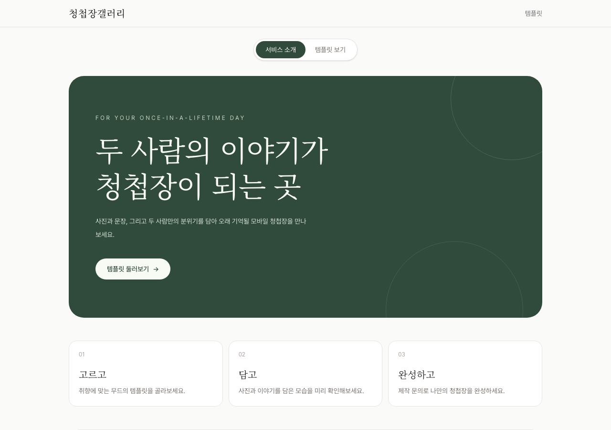
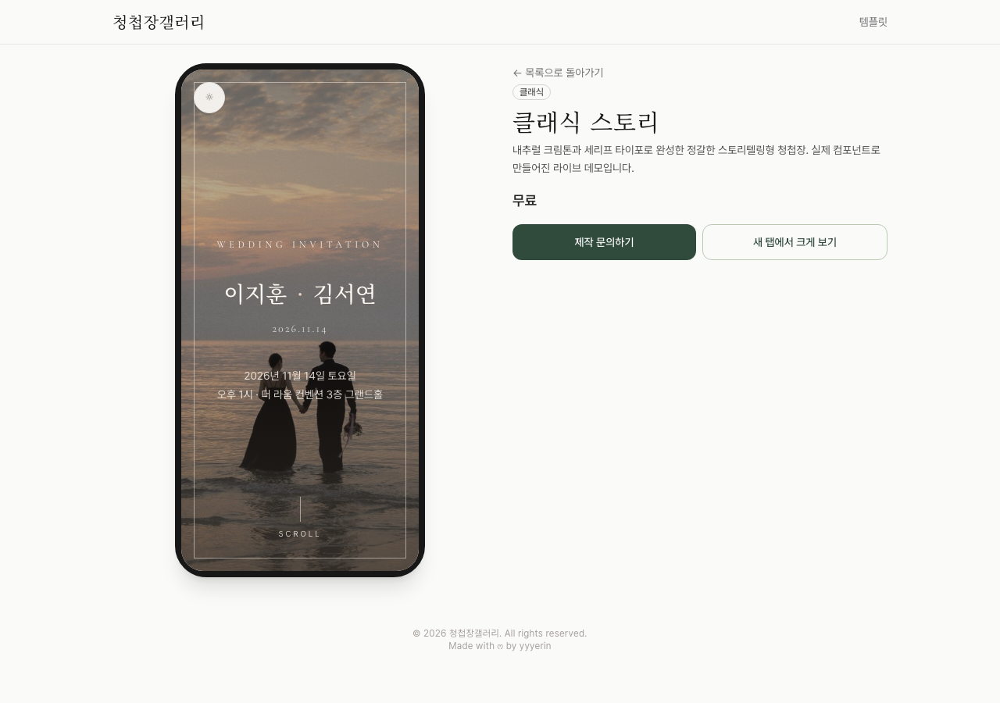
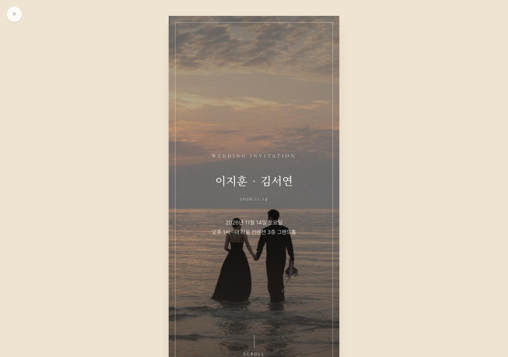

# 💌 청첩장갤러리

모바일 청첩장 템플릿을 모아 보여주는 갤러리 서비스입니다. 템플릿을 둘러보고 마음에 드는 디자인을 골라 제작을 문의하는 방식으로, 사용자가 직접 데이터를 입력해 만드는 셀프빌더는 아닙니다.

⚛️ React + ⚡ Vite + TypeScript + 🎨 Tailwind CSS로 만들었고, 모바일/데스크톱 모두 지원합니다.

🔗 **배포 링크**: [invite.yyyerin.co.kr](https://invite.yyyerin.co.kr/)



## 🚀 시작하기

```bash
npm install
npm run dev
```

| 명령 | 설명 |
| --- | --- |
| `npm run dev` | 개발 서버 실행 |
| `npm run build` | 타입 체크 후 프로덕션 빌드 |
| `npm run preview` | 빌드 결과 로컬 미리보기 |
| `npm run lint` | oxlint로 정적 분석 |

## 📱 주요 화면

| 템플릿 상세 | 라이브 프리뷰 |
| --- | --- |
|  |  |

- **템플릿 갤러리** (`/`) — 카테고리(미니멀/클래식/로맨틱/유니크/포토)별로 템플릿을 필터링해 둘러볼 수 있습니다.
- **템플릿 상세** (`/templates/:id`) — 템플릿 정보와 폰 목업 미리보기, "제작 문의하기" 모달 폼을 제공합니다. 실제 컴포넌트로 만들어진 템플릿은 목업 안에 실제 페이지가 그대로 렌더링됩니다.
- **라이브 프리뷰** (`/preview/:id`) — 실제 템플릿을 목업 없이 풀페이지로 확인하는 라우트입니다.

## 🖼️ 템플릿 구조

`src/data/templates.ts`에 갤러리에 노출되는 템플릿 목록(제목, 카테고리, 설명, 가격, 썸네일 등)이 있습니다.

일부 템플릿은 그래디언트 플레이스홀더로만 존재하고, 일부는 `src/templates/{템플릿명}/` 아래에 실제 React 컴포넌트로 구현되어 있습니다. 실제 컴포넌트가 있는 템플릿은 `src/templates/registry.ts`에 id로 등록해야 상세 페이지 프리뷰(iframe)와 `/preview/:id` 라우트에서 렌더링됩니다.

현재 라이브 템플릿:

| id | 이름 | 카테고리 | 특징 |
| --- | --- | --- | --- |
| `classic-story` | 클래식 스토리 | 클래식 | 내추럴 크림톤 + 세리프 타이포의 스토리텔링형 청첩장 |
| `minimal-mono` | 미니멀 모노톤 | 미니멀 | 그레이스케일 사진과 좌측 정렬 에디토리얼 타이포그래피 |
| `romantic-blossom` | 핑크 블라썸 스토리 | 로맨틱 | 벚꽃이 흩날리는 봄날 무드의 블러쉬 핑크 톤 |
| `retro-film` | 레트로 필름 다이어리 | 유니크 | 필름 카메라 그레인과 폴라로이드 감성의 다이어리형 구성 |
| `photo-story` | 포토 스토리 | 포토 | 화이트 갤러리 벽에 사진을 건 듯한 여백 중심의 포토 구성 |
| `garden-editorial` | 가든 에디토리얼 | 로맨틱 | 짙은 포레스트 그린과 식물원 에디토리얼 무드 |
| `pastel-spring` | 파스텔 스프링 | 로맨틱 | 민트빛 아이보리 + 블러쉬 핑크 + 버터 옐로우의 봄날 무드 |

각 템플릿 폴더는 `{TemplateName}.tsx`, `assets/`, `components/`, `hooks/`, `utils/`, `sampleData.ts`, `types.ts` 구조를 공통으로 따릅니다.

새 라이브 템플릿을 추가하려면:

1. `src/templates/{새 템플릿}/`에 컴포넌트를 작성합니다.
2. `src/templates/registry.ts`의 `templateComponents`에 id와 `lazy(() => import(...))`를 등록합니다.
3. `src/data/templates.ts`에 같은 id로 갤러리 카드용 메타데이터를 추가합니다.

## 📩 문의 폼 (EmailJS)

"제작 문의하기" 모달은 [EmailJS](https://www.emailjs.com/)로 이메일을 직접 전송합니다(별도 백엔드 없음). 사용하려면:

1. EmailJS에서 이메일 서비스와 템플릿을 만듭니다. 템플릿에는 `{{template_name}}`, `{{name}}`, `{{phone}}`, `{{wedding_date}}`, `{{venue}}`, `{{message}}` 변수를 사용하고, 받는 주소는 템플릿/서비스 설정에서 지정합니다.
2. 프로젝트 루트에 `.env.local`을 만들고 `.env.example`을 참고해 다음 값을 채웁니다.

   ```bash
   VITE_EMAILJS_SERVICE_ID=
   VITE_EMAILJS_TEMPLATE_ID=
   VITE_EMAILJS_PUBLIC_KEY=
   ```

3. 개발 서버를 재시작하면 반영됩니다.

`.env.local`은 git에 커밋되지 않습니다.

## 🛠️ 기술 스택

- ⚛️ **React 19** + **TypeScript** — UI와 타입 안정성
- ⚡ **Vite** — 개발 서버 및 빌드
- 🧭 **React Router** — 갤러리 / 상세 / 프리뷰 라우팅
- 🎨 **Tailwind CSS v4** — 스타일링
- 📧 **EmailJS** — 백엔드 없이 문의 폼 이메일 전송
- 🔍 **oxlint** — 정적 분석
